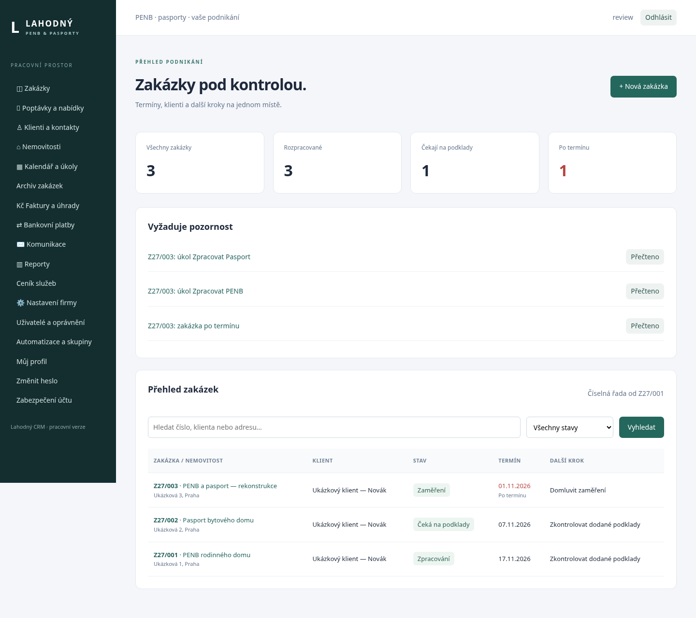

# Lahodný CRM — PENB, pasporty a fakturace

Webové CRM v češtině pro Windows a mobilní prohlížeč. Data se ukládají do SQLite; přihlašování a oprávnění zajišťuje Django. Aktuální verze rozšiřuje původní základ o celý hlavní průchod od poptávky po úhradu a archiv.



## Nejjednodušší spuštění na Windows

1. Nainstalujte Python 3.12 nebo novější včetně launcheru `py`.
2. Stáhněte repozitář přes **Code → Download ZIP** a rozbalte jej.
3. Spusťte **Spustit-CRM.bat**.
4. Při prvním spuštění vytvořte vlastní účet správce. Žádné výchozí heslo neexistuje.
5. Otevře se prohlížeč. Terminál během práce nezavírejte.

Spouštěč připraví databázi a statické soubory a použije Waitress bez debug režimu. Každých pět minut provede kontrolu termínů a pravidel upomínek. Vypnutý počítač tyto úlohy neprovádí.

Pro Android na stejné důvěryhodné domácí Wi-Fi slouží **Spustit-CRM-WiFi.bat**. Podrobný [návod](docs/WINDOWS.md). Pro přístup mimo domov je nutné HTTPS nasazení; žádná veřejná adresa zatím nebyla vytvořena.

Při aktualizaci zachovejte `db.sqlite3`, `media/` a `.local-secret`. Nejprve vytvořte zálohu. Nenahrazujte svou datovou složku novým prázdným ZIPem.

## Hlavní funkce

- Klienti, kontaktní osoby, adresy, IČO/DIČ, nemovitosti a parcely.
- Poptávka z veřejného formuláře včetně příloh a ochrany proti opakovanému odeslání.
- Verze cenových nabídek, klientské potvrzení přes soukromý odkaz a přenos fakturačních údajů.
- Převod potvrzené poptávky na zakázku bez duplikace.
- Zakázky od Z27/001, termíny, stav, popis, poznámky, historie a další krok.
- Složky dokumentů, verze, přesun, přejmenování, koš, soukromé stahování a individuální sdílení interních dokumentů.
- Klientské odkazy pro dodávání podkladů a povolené finální výstupy, s expirací a odvoláním.
- Úkoly, zaměření se začátkem návštěvy, měsíční kalendář, plánované a skutečné hodiny.
- Schvalování víceprací se změnou ceny a termínu.
- Ceník a předvyplnění nabídky či fakturační položky.
- Návrhy faktur ze zakázky i bez zakázky, řada PF, VS a česká QR platba.
- PDF s českými znaky, uložené údaje odběratele a dodavatele, uzamčení vystaveného dokladu.
- Zálohové výzvy a odečet jedné uhrazené zálohy do konečné faktury.
- Potvrzení tisku, příprava e-mailu s PDF a evidence skutečného výsledku SMTP.
- Ruční platby, částečné úhrady, přeplatky, vrácení a oprava chybného záznamu s historií.
- CSV import bankovních příjmů s kontrolou duplicit a ručním přiřazením nejasných plateb.
- Připravované upomínky ve třech stupních, pozastavení a zastavení po úhradě.
- Upozornění na úkoly a termíny.
- Reporty cen, fakturace, přijatých peněz, nákladů, pohledávek, konverzí a kapacity, CSV export.
- Předání dokumentů, uzamčený archiv, kontrolní součty, retenční lhůta a blokace skartace.
- Záloha v nastavení, příkazy pro ověřenou obnovu do nové složky.
- Nastavení uživatelů, oprávnění, finanční viditelnosti a rozsahu zakázek.
- Dvoufázové ověření s obnovovacími kódy, ochrana přihlášení, změna a obnova hesla.

**Není to ještě kompletní produkční řešení všech rozšíření.** Přesné hranice jsou v [přehledu funkcí](docs/FEATURES.md). Zejména není připojena skutečná pošta, bankovní API ani veřejný hosting. PDF používá rozvržení inspirované Excelovou předlohou, není její pixelově přesnou kopií. Účetní opravné doklady a další specializované integrace dosud nejsou dokončené.

## První pracovní průchod

1. V Nastavení zkontrolovat dodavatele, účet, rok faktur a další pořadí.
2. Založit klienta nebo přijmout poptávku přes `/poptavka/`.
3. Připravit nabídku, zkontrolovat zprávu v Komunikaci a odeslat po připojení SMTP.
4. Klient potvrdí nabídku a fakturační údaje přes její odkaz.
5. Vytvořit zakázku, ověřit termín, přiřadit práci a nahrát podklady.
6. Připravit fakturu, zkontrolovat návrh, vystavit, otevřít PDF a potvrdit tisk.
7. Zprávu s fakturou zkontrolovat v Komunikaci.
8. Ručně nebo importem zaevidovat úhradu. Plná úhrada se zobrazí zeleně.
9. Dokončit úkoly, označit finální výstupy, zaznamenat předání a archivovat.

## Číslování

Zakázky začínají na **Z27/001**; aktuální pravidlo obnovuje pořadí po změně roku. Provoz před rokem 2027 používá pilotní řadu 2027. Přidělená čísla se znovu nepoužívají.

Faktury mají samostatnou řadu **PF 27001** apod. Rok a další pořadí se nastavují; rok vystavení musí odpovídat nastavené řadě. Při pokračování staré řady PF 26013 nejprve ověřit poslední vystavený doklad a nastavit správný rok a pořadí.

VS zakázky Z27/001: první doklad **2700101**, druhý **2700102**. Formát podporuje maximálně 999 zakázek v roce a 99 dokladů na zakázku; rozšíření řady vyžaduje vědomou změnu formátu. Samostatná faktura používá číslice svého čísla, např. PF 27003 → VS 27003. Pro vysoká samostatná pořadí je vyhrazen devítimístný prostor, aby nekolidoval se zakázkovými VS. Číslo faktury i VS se přidělují až při vystavení.

## Vývoj a ověření

Použít existující checkout, nevytvářet další worktree.

```sh
python -m venv .venv
.venv/bin/python -m pip install -r requirements.txt
.venv/bin/python manage.py migrate
.venv/bin/python manage.py test
.venv/bin/python run_crm.py --no-browser
```

Na Windows odpovídají příkazy cestě `.venv\Scripts\python.exe`.

[Dokumentace provozu a integrací](docs/OPERATIONS.md) · [Stav požadavků](docs/FEATURES.md) · [Pokračování práce](docs/CONTINUE.md)
